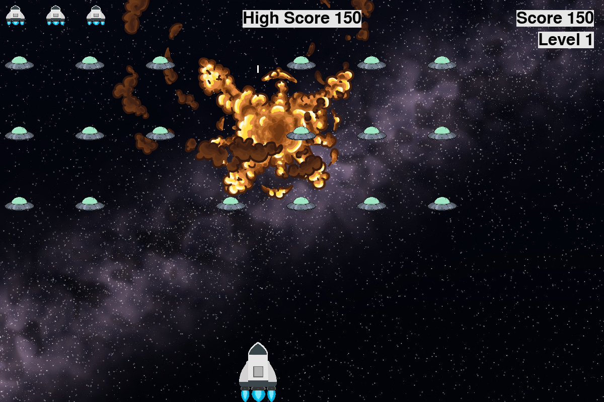
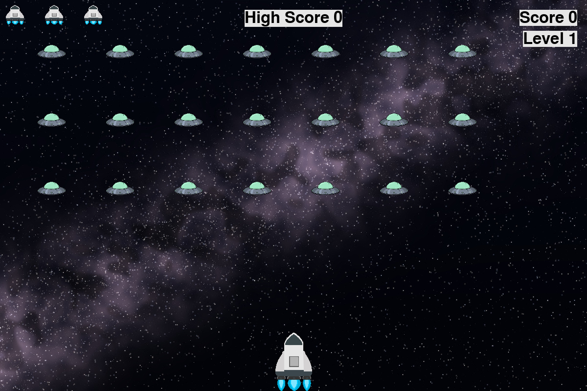

# Alien Invasion

A 2D space shooter built with **Python** and **Pygame**, structured with object-oriented programming: every part of the game is its own class.



## Gameplay

- Move your ship left and right and shoot down the alien fleet before it reaches the bottom.
- The fleet moves sideways, drops down at each edge, and comes back faster at every new level.
- You have 3 ships. Lose them all and it's game over.
- Points per alien increase with each level, and your **high score is saved** between sessions.

| Key | Action |
|---|---|
| ← → | Move |
| Space | Shoot |
| Mouse click on **Play** | Start a new game |
| Esc | Quit |

## Project structure

Each class lives in its own file and has one job:

| File | Class | Responsibility |
|---|---|---|
| `alien_invasion.py` | `AlienInvasion` | Main game: game loop, events, collisions, fleet creation |
| `settings.py` | `Settings` | All game settings, plus speeding up the game each level |
| `ship.py` | `Ship` | The player's ship and its movement |
| `alien.py` | `Alien` | A single alien and edge detection |
| `bullet.py` | `Bullet` | A bullet fired by the ship |
| `explosion.py` | `Explosion` | Animated explosion when an alien is hit |
| `gamestats.py` | `GameStats` | Score, level, lives, saving and loading the high score |
| `scoreboard.py` | `ScoreBoard` | Draws score, high score, level and remaining ships |
| `button.py` | `Button` | The Play button |

`AlienInvasion` creates all the other objects and passes itself to them, so each class can reach shared things like the screen and settings.

## What I added beyond the base game

- **Explosion animation** (10 frames) where an alien is destroyed
- **Sound effects** for shooting and explosions
- **Space background** and custom ship and alien images
- **High score saved to a JSON file**, so it survives restarting the game
- **Resizable window**: the background and scoreboard adjust to the new size

## Run it

```bash
pip install pygame
python alien_invasion.py
```

Run it from inside this folder, because images and sounds are loaded with relative paths.



## What I learned

- Designing a program as a set of classes with clear responsibilities
- Inheritance with `pygame.sprite.Sprite`, and managing many objects with sprite groups
- Writing a game loop: handle events, update objects, redraw the screen
- Collision detection, and saving data to a file with JSON

## Credits

Based on the Alien Invasion project in *Python Crash Course* by Eric Matthes, extended with my own features.
Explosion frames from the free animated explosion sprite pack by [CraftPix](https://craftpix.net/). The space background is a procedurally generated starfield.
